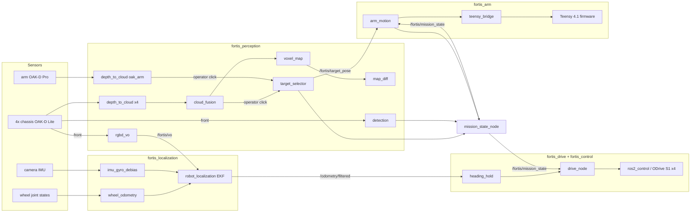
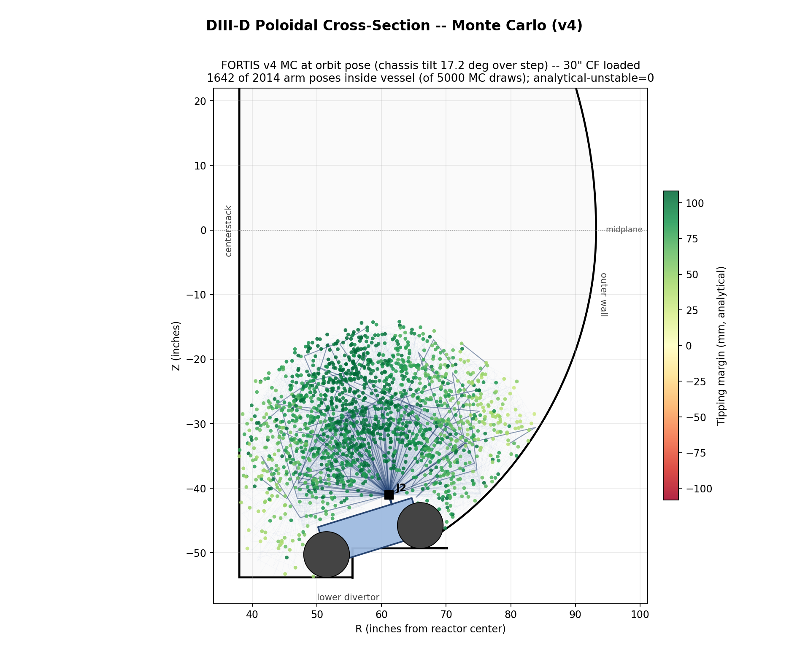

# FORTIS

FORTIS is a remotely operated inspection robot for the DIII-D tokamak at General Atomics, built as a sponsored senior design project at UC Santa Cruz. It enters the vessel through a 15.75 inch square access tunnel, drives on the reactor floor on four omni wheels, and carries a 4-DOF arm for camera inspection. The team had real hardware for only the last two weeks of the project, so nearly everything in this repo was developed and tested in simulation first. Two weeks after the hardware arrived, the robot drove the sponsor's full tunnel mockup with zero tipping events.

## My role

Nikhil Thankasala, Team Lead and Software Lead on a five-person team. I wrote the ROS 2 stack under `src/`, the Isaac Sim studies under `sim/`, and the host side of the arm firmware protocol.

## System architecture

ROS 2 Humble on a Jetson Orin Nano. The mission state machine gates every motion-producing node.



## Simulation

Code: [`sim/`](sim/README.md), NVIDIA Isaac Sim 5.1.

- [`xdrive_realwheel.py`](sim/isaac/xdrive/canonical/xdrive_realwheel.py) models the chassis with every omni-wheel roller as its own rigid body on a free-spinning revolute joint: 10 rollers on each of 4 wheels, 40 roller joints, 44 DOF in total. It can load the DIII-D vessel geometry so the robot straddles the 4.5 inch floor step.
- [`arm_mc_sweep_v4.py`](sim/isaac/xdrive/tools/arm_mc_sweep_v4.py) is a 5,000-pose Monte Carlo sweep over the four arm joints. Each pose records joint torques and whether the chassis tips, with the chassis set to its lightest plausible mass as the worst case. [`arm_mc_filter_v4.py`](sim/isaac/xdrive/tools/arm_mc_filter_v4.py) then removes poses that collide with the chassis, the floor, the arm itself, or the vessel envelope.
- The sweep sized the arm actuators. Results and raw data are in [`results/arm_mc_sweep/`](sim/isaac/xdrive/results/arm_mc_sweep/RESULTS.md).



## Manipulation

Code: [`src/fortis_arm`](src/fortis_arm/README.md), [`firmware/teensy`](firmware/teensy/PROTOCOL.md).

- [`arm_ik.py`](src/fortis_arm/fortis_arm/arm_ik.py): forward and inverse kinematics for the 4-DOF arm (base yaw, shoulder, elbow, wrist). Returns elbow-up and elbow-down solutions that respect the URDF joint limits.
- [`arm_motion_node.py`](src/fortis_arm/fortis_arm/arm_motion_node.py): `MoveToPose` action server. It solves IK for the goal, picks the solution nearest the current joint state, rejects unreachable targets, and stops the arm on cancel or timeout. Goals are accepted only in mission states that allow arm motion.
- [`teensy_bridge_node.py`](src/fortis_arm/fortis_arm/teensy_bridge_node.py): serial bridge to the Teensy 4.1. Before each move it scales the three stepper speeds so all joints finish together, with the slowest joint setting the move time. The firmware then runs one coordinated move with a trapezoidal velocity profile on the stepper group.
- Planning is joint-space only. There is no collision-aware path planner in this repo.

## Perception

Code: [`src/fortis_perception`](src/fortis_perception/README.md). Runs on CPU on the Jetson Orin Nano.

- Four chassis depth cameras (front, rear, left, right) are back-projected to point clouds and fused into one cloud in the robot frame ([`cloud_fusion_node.py`](src/fortis_perception/fortis_perception/cloud_fusion_node.py)).
- The fused cloud is integrated into a persistent voxel grid ([`voxel_grid.py`](src/fortis_perception/fortis_perception/voxel_grid.py)). A saved grid from one run is the reference for change detection in the next ([`map_diff_node.py`](src/fortis_perception/fortis_perception/map_diff_node.py)), which reports added and removed voxels.
- The fifth camera, on the arm, is kept out of the fused map. `arm_camera_id:=<serial>` gives it its own cloud for click targeting. This path has not been run on hardware.
- [`target_selector_node.py`](src/fortis_perception/fortis_perception/target_selector_node.py) turns an operator click on a point cloud in Foxglove into the arm target pose.
- [`detectors.py`](src/fortis_perception/fortis_perception/detectors.py): YOLOv8 object detection from an ONNX export (`detector:=yolo`), with an HSV blob detector as the default for tests. Detections are lifted to 3D through the depth image.
- [`rgbd_vo.py`](src/fortis_perception/fortis_perception/rgbd_vo.py): RGB-D visual odometry (ORB features, PnP with RANSAC) on the front camera, published for the EKF.

## Motion control

Code: [`src/fortis_drive`](src/fortis_drive/README.md), [`src/fortis_comms`](src/fortis_comms/README.md), [`src/fortis_control`](src/fortis_control/README.md).

- [`xdrive_kinematics.py`](src/fortis_comms/fortis_comms/xdrive_kinematics.py): forward and inverse kinematics for the omni-wheel X-drive.
- [`drive_node.py`](src/fortis_drive/fortis_drive/drive_node.py): converts velocity commands to wheel speeds, gated by mission state, with a command watchdog.
- [`heading_hold_node.py`](src/fortis_drive/fortis_drive/heading_hold_node.py): heading-hold PID on the EKF yaw, with anti-windup. The operator's turn command passes through, and the controller holds the heading at release.
- `fortis_control` wires the four ODrive S1 controllers through `ros2_control` over CAN.

## Estimation

Code: [`src/fortis_localization`](src/fortis_localization/README.md).

- A `robot_localization` EKF fuses wheel odometry, the camera IMU, and visual odometry ([`ekf_vio.yaml`](src/fortis_localization/config/ekf_vio.yaml), enabled with `vio:=true`).
- The gyro is the only yaw input. Wheel odometry and visual odometry contribute planar velocity only, so wheel slip cannot corrupt heading.
- [`imu_gyro_debias_node.py`](src/fortis_localization/fortis_localization/imu_gyro_debias_node.py) estimates gyro bias while the drive is disarmed.
- [`wheel_odometry_node.py`](src/fortis_localization/fortis_localization/wheel_odometry_node.py) also publishes a wheel-slip residual for diagnostics.

## Mission and testing

Code: [`src/fortis_safety`](src/fortis_safety/README.md), [`src/fortis_integration_tests`](src/fortis_integration_tests/README.md), [`src/fortis_sim_support`](src/fortis_sim_support/README.md).

- [`mission_state_machine.py`](src/fortis_safety/fortis_safety/mission_state_machine.py): table-driven state machine with nine states (IDLE, ORBIT, TARGETING, ARM_AT_VIEW, INSPECT, PICK, HOLDING, RETURN_HOME, FAULT) and guarded transitions.
- [`test_full_mission.py`](src/fortis_integration_tests/test/test_full_mission.py): software-in-the-loop test of the whole mission. It runs the real nodes against a synthetic camera rig ([`fortis_sim_support`](src/fortis_sim_support/README.md)) and a firmware mock ([`tools/mock_teensy.py`](tools/mock_teensy.py)), and drives the state machine from IDLE through a pick and back.
- [`test_multicam_fusion.py`](src/fortis_integration_tests/test/test_multicam_fusion.py) and [`test_perception_chain.py`](src/fortis_integration_tests/test/test_perception_chain.py) cover four-camera fusion and the perception chain.
- CI ([`ci.yml`](.github/workflows/ci.yml)) builds the workspace and runs the tests on every pull request.

## Results

- Hardware: the robot drove the sponsor's full tunnel mockup with zero tipping events, two weeks after hardware arrived. The arm and the chassis were tested separately; the arm was not mounted on the chassis for the final demo.
- Arm sweep: of 5,000 sampled poses, 2,014 are reachable and collision-free, and 1,989 of those (98.8%) stay upright with the worst-case chassis mass. Peak torque on every joint is below 60% of its continuous rating.
- Visual odometry: 0.7% trajectory error on the TUM RGB-D `freiburg1_xyz` sequence ([`test_rgbd_vo_tum.py`](src/fortis_perception/test/test_rgbd_vo_tum.py)).

## Repo layout

```
src/                ROS 2 packages (colcon workspace), one README each
  fortis_arm/           arm IK, MoveToPose, Teensy bridge
  fortis_perception/    clouds, fusion, voxel map, change detection, VO, detection
  fortis_localization/  wheel odometry, gyro debias, EKF config
  fortis_drive/         X-drive command pipeline, heading hold, orbit
  fortis_control/       ros2_control wiring for the ODrive S1s
  fortis_comms/         X-drive kinematics, shared QoS profiles
  fortis_safety/        mission state machine, drive health monitor
  fortis_bringup/       launch files and parameters
  fortis_description/   URDF / xacro
  fortis_msgs/          messages, services, actions
  fortis_sim_support/   synthetic camera rig
  fortis_integration_tests/  cross-package launch tests
firmware/teensy/    Teensy 4.1 arm firmware and serial protocol
sim/                Isaac Sim scripts, analysis, results
docker/             dev containers (CPU and GPU)
foxglove/           operator layouts
tools/              firmware mock, ODrive calibration and tuning
```

## Build and run

The dev container is ROS 2 Humble. See [`docker/README.md`](docker/README.md) for the GPU variant.

```bash
docker compose -f docker/docker-compose.yml up -d
```

```bash
docker exec -it fortis-dev bash
```

Inside the container (the repo is mounted at `/workspace`):

```bash
cd /workspace && ./tools/vendor_import.sh
```

```bash
source /opt/ros/humble/setup.bash && colcon build --symlink-install
```

```bash
source install/setup.bash && colcon test --executor sequential && colcon test-result --verbose
```

Perception demo with no hardware, four synthetic cameras, viewable in Foxglove on port 8765:

```bash
ros2 launch fortis_bringup perception.launch.py cameras:=oak_chassis_front,oak_chassis_rear,oak_chassis_left,oak_chassis_right
```

Full mission test on its own:

```bash
launch_test src/fortis_integration_tests/test/test_full_mission.py
```

Isaac Sim scripts run on a host with Isaac Sim 5.1; commands are in [`sim/README.md`](sim/README.md).

## Team

Five-person team, sponsored by General Atomics.

- Nikhil Thankasala: Team Lead and Software Lead
- Cesar Cuevas: arm firmware bring-up on the Teensy 4.1
- Adrian and Carlos: CAD export for the robot URDF
